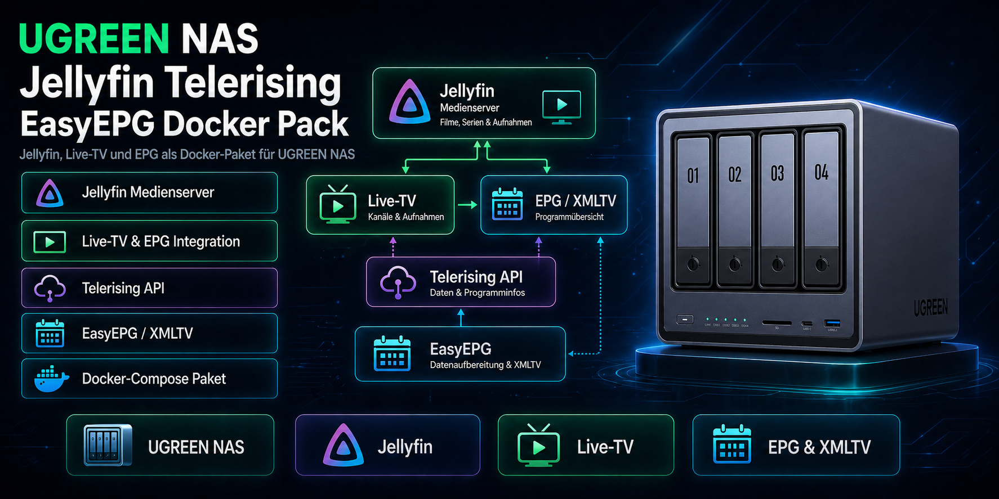

# Jellyfin + Telerising + EasyEPG DockerPack für UGREEN NAS

[](https://github.com/Railsimulatornet/UGREEN-NAS-Jellyfin-Telerising-EasyEPG-DockerPack/actions/workflows/compose-validation.yml)
[](LICENSE)



[Deutsch](#deutsch) · [English](#english)

## Deutsch

Docker-Projekt für **UGREEN NAS mit UGOS Pro**: Jellyfin für Medien und Live-TV, SWAG als Reverse Proxy, EasyEPG und Telerising. Das Paket enthält separate Compose-Dateien für DXP-Geräte mit Intel-Grafik und DH-Geräte mit Rockchip-Hardware.

### Funktionen

- Jellyfin Media Server mit Live-TV und XMLTV-Programmdaten aus EasyEPG.
- Telerising für Live-TV-Streams.
- SWAG mit HTTPS, WebSocket-Weiterleitung und vorkonfiguriertem Fail2Ban-Anmeldefilter.
- Zentrale `.env` für Pfade, Ports, Domain und Benutzerrechte.
- Deutsche und englische Paketquellen mit jeweils passendem PDF-Handbuch.

### Voraussetzungen

- UGREEN NAS mit Docker-App oder Docker Compose.
- Medienordner und passende Zugriffsrechte für die konfigurierten Benutzer und Gruppen.
- Die in der gewählten Compose-Datei eingetragenen Grafikgeräte müssen auf der NAS vorhanden sein.
- Für externen Zugriff: eigene Domain, passende DNS-Einträge und Routerfreigaben für SWAG.

| Gerät / Grafik | Compose-Datei | Durchgereichte Geräte |
|---|---|---|
| DXP / Intel | `docker-composeDXP.yaml` | `/dev/dri` |
| DH / Rockchip | `docker-composeDH.yaml` | `/dev/dri`, `/dev/dma_heap`, `/dev/rga`, `/dev/mpp_service`, `/dev/mali0` |

Die DH-Konfiguration startet Jellyfin mit `privileged: true` und gelockerten Sicherheitsprofilen für den Hardwarezugriff. Verwende diese Variante nur auf dem dazu passenden System. Die Hardwarebeschleunigung richtest du anschließend in Jellyfin entsprechend deinem Gerät ein.

### Schnellstart

1. Lade aus dem [aktuellen Release](https://github.com/Railsimulatornet/UGREEN-NAS-Jellyfin-Telerising-EasyEPG-DockerPack/releases/latest) die ZIP mit Endung `_de.zip` oder `_en.zip` herunter.
2. Entpacke sie nach `/volume2/docker/`. Danach liegt das Projekt unter `/volume2/docker/JellyfinServer/`.
3. Passe `JellyfinServer/.env` an. Prüfe insbesondere Medienpfade, Benutzerrechte und die SWAG-Domain.
4. Wähle die Compose-Datei für dein Gerät und benenne diese Kopie in **`docker-compose.yaml`** um. Verwende nur eine Variante für das Projekt.
5. Öffne die UGREEN Docker-App, wähle **Projekte → Importieren**, importiere `JellyfinServer` und starte das Projekt.
6. Öffne Jellyfin unter `http://<NAS-IP>:8096`, sofern du den HTTP-Port nicht geändert hast.

Alternativ per SSH nach Auswahl der Compose-Datei:

```bash
cd /volume2/docker/JellyfinServer
docker compose --env-file .env config --quiet
docker compose up -d
```

Bei Installation aus dem Repository kopierst du `v1/de/JellyfinServer/` oder `v1/en/JellyfinServer/` vollständig an diesen Zielort, einschließlich `.env` und der vorbereiteten Unterordner.

### Konfiguration

| Bereich | Werte in `.env` |
|---|---|
| Medien und Jellyfin | `MEDIA_DIR`, `JELLYFIN_SYSTEM_DIR`, `JELLYFIN_CONFIG_DIR` |
| Benutzerrechte und Zeit | `PUID`, `PGID`, `JELLYFIN_UMASK`, `TZ` |
| SWAG | `SWAG_URL`, `SWAG_SUBDOMAINS`, `SWAG_EMAIL`, `SWAG_CONFIG_DIR`, `SWAG_FAIL2BAN_ENABLED` |
| EasyEPG | `EASYEPG_APP_DIR`, `EASYEPG_XML_DIR`, `USER_ID`, `GROUP_ID`, `EASYEPG_UPDATE` |
| Telerising | `TELERISING_DIR`, `TELERISING_UID`, `TELERISING_GID`, `TELERISING_UPDATE` |

Relative Pfade wie `./Jellyfin/config` beziehen sich auf den Projektordner. Die vollständige Vorlage steht unter [v1/de/JellyfinServer/.env](v1/de/JellyfinServer/.env).

#### Standardports

| Dienst | NAS-Port | Verwendung |
|---|---|---|
| Jellyfin | `8096/tcp` | Lokale Weboberfläche |
| Jellyfin Discovery / DLNA | `7359/udp`, `1900/udp` | Erkennung im Netzwerk |
| SWAG HTTP / HTTPS | `5080/tcp`, `50443/tcp` | Container-Ports 80 und 443 |
| Jellyfin-Proxy in SWAG | `8920/tcp` | Mitgelieferter Jellyfin-HTTPS-Listener |
| Zusätzliche SWAG-Portabbildung | `58080/tcp` | Container-Port 8080; benötigt einen passenden Listener |
| EasyEPG / Telerising | `4000/tcp`, `5000/tcp` | Weboberflächen und API |

#### Reverse Proxy

Die mitgelieferte [Jellyfin-Proxydatei](v1/de/JellyfinServer/linuxserver_swag/config/nginx/proxy-confs/jellyfin.subdomain.conf) lauscht auf **8920** und verwendet `jellyfin.*` als Servernamen. Behalte die Subdomain `jellyfin` bei oder passe auch diese Datei an.

Bei unveränderter Konfiguration erreichst du den Proxy über `https://jellyfin.example.com:8920`, wenn DNS und Netzwerkzugriff eingerichtet sind. Für die externe URL ohne Portangabe leite Router-Port **443 auf NAS-Port 8920** weiter. Router-Port **80** führt auf den SWAG-HTTP-Port, standardmäßig **5080**. Geänderte Ports müssen auch in den Routerregeln berücksichtigt werden.

Trage den Reverse Proxy in Jellyfins Netzwerkeinstellungen als **bekannten Proxy** ein. Verwende dazu die tatsächliche Container-IP des SWAG-Proxys.

### Aktualisierung

Sichere deine Konfiguration. Behalte die angepasste `.env`, die gewählte `docker-compose.yaml` und die Containerdaten. Aktualisiere die Images in der Docker-App oder im Projektordner:

```bash
docker compose pull
docker compose up -d
```

Übernimm Änderungen aus neuen Paketen gezielt in deine vorhandenen Dateien.

### Projektstruktur und Dokumentation

| Inhalt | Pfad |
|---|---|
| Deutsche Paketquelle | [v1/de/JellyfinServer/](v1/de/JellyfinServer/) |
| Englische Paketquelle | [v1/en/JellyfinServer/](v1/en/JellyfinServer/) |
| Handbuch Deutsch | [JellyfinServer_Handbuch_DE_v1_jellyfin.pdf](v1/de/JellyfinServer_Handbuch_DE_v1_jellyfin.pdf) |
| Handbuch Englisch | [JellyfinServer_Handbuch_EN_v1_jellyfin.pdf](v1/en/JellyfinServer_Handbuch_EN_v1_jellyfin.pdf) |

Der Workflow [Compose Validation](https://github.com/Railsimulatornet/UGREEN-NAS-Jellyfin-Telerising-EasyEPG-DockerPack/actions/workflows/compose-validation.yml) baut ZIPs aus den eingecheckten DE-/EN-Quellen. Er prüft beide Compose-Varianten und die Anmeldefilter in den entpackten Paketen. Die geprüften ZIPs werden mit Commit-SHA und Prüfsummen als CI-Artefakt bereitgestellt; fertige Veröffentlichungen stehen unter **Releases**.

### Lizenz

[MIT-Lizenz](LICENSE). Roman Glos / Railsimulatornet.

## English

Docker project for **UGREEN NAS running UGOS Pro**: Jellyfin for media and live TV, SWAG as a reverse proxy, EasyEPG and Telerising. The package includes separate Compose files for DXP devices with Intel graphics and DH devices with Rockchip hardware.

### Features

- Jellyfin Media Server with live TV and XMLTV programme data from EasyEPG.
- Telerising for live TV streams.
- SWAG with HTTPS, WebSocket forwarding and a preconfigured Fail2Ban authentication filter.
- A central `.env` for paths, ports, domain and user permissions.
- German and English package sources, each with a matching PDF manual.

### Requirements

- UGREEN NAS with the Docker app or Docker Compose.
- Media folders and suitable access permissions for the configured users and groups.
- The graphics devices listed in the selected Compose file must exist on the NAS.
- For external access: your own domain, suitable DNS records and router forwarding for SWAG.

| Device / graphics | Compose file | Mapped devices |
|---|---|---|
| DXP / Intel | `docker-composeDXP.yaml` | `/dev/dri` |
| DH / Rockchip | `docker-composeDH.yaml` | `/dev/dri`, `/dev/dma_heap`, `/dev/rga`, `/dev/mpp_service`, `/dev/mali0` |

The DH configuration starts Jellyfin with `privileged: true` and relaxed security profiles for hardware access. Use this variant only on a matching system. Then configure hardware acceleration in Jellyfin for your device.

### Quick start

1. Download the ZIP ending in `_en.zip` or `_de.zip` from the [latest release](https://github.com/Railsimulatornet/UGREEN-NAS-Jellyfin-Telerising-EasyEPG-DockerPack/releases/latest).
2. Extract it into `/volume2/docker/`. The project will be at `/volume2/docker/JellyfinServer/`.
3. Edit `JellyfinServer/.env`. Check the media paths, user permissions and SWAG domain in particular.
4. Select the Compose file for your device and rename that copy to **`docker-compose.yaml`**. Use only one variant for the project.
5. Open the UGREEN Docker app, select **Projects → Import**, import `JellyfinServer` and start the project.
6. Open Jellyfin at `http://<NAS-IP>:8096` unless you changed the HTTP port.

Alternatively, run these commands over SSH after selecting the Compose file:

```bash
cd /volume2/docker/JellyfinServer
docker compose --env-file .env config --quiet
docker compose up -d
```

When installing from the repository, copy the complete `v1/en/JellyfinServer/` or `v1/de/JellyfinServer/` folder to this destination, including `.env` and the prepared subfolders.

### Configuration

| Area | Values in `.env` |
|---|---|
| Media and Jellyfin | `MEDIA_DIR`, `JELLYFIN_SYSTEM_DIR`, `JELLYFIN_CONFIG_DIR` |
| User permissions and time | `PUID`, `PGID`, `JELLYFIN_UMASK`, `TZ` |
| SWAG | `SWAG_URL`, `SWAG_SUBDOMAINS`, `SWAG_EMAIL`, `SWAG_CONFIG_DIR`, `SWAG_FAIL2BAN_ENABLED` |
| EasyEPG | `EASYEPG_APP_DIR`, `EASYEPG_XML_DIR`, `USER_ID`, `GROUP_ID`, `EASYEPG_UPDATE` |
| Telerising | `TELERISING_DIR`, `TELERISING_UID`, `TELERISING_GID`, `TELERISING_UPDATE` |

Relative paths such as `./Jellyfin/config` refer to the project folder. See [v1/en/JellyfinServer/.env](v1/en/JellyfinServer/.env) for the complete template.

#### Default ports

| Service | NAS port | Purpose |
|---|---|---|
| Jellyfin | `8096/tcp` | Local web interface |
| Jellyfin Discovery / DLNA | `7359/udp`, `1900/udp` | Network discovery |
| SWAG HTTP / HTTPS | `5080/tcp`, `50443/tcp` | Container ports 80 and 443 |
| Jellyfin proxy in SWAG | `8920/tcp` | Supplied Jellyfin HTTPS listener |
| Additional SWAG port mapping | `58080/tcp` | Container port 8080; requires a matching listener |
| EasyEPG / Telerising | `4000/tcp`, `5000/tcp` | Web interfaces and API |

#### Reverse proxy

The supplied [Jellyfin proxy file](v1/en/JellyfinServer/linuxserver_swag/config/nginx/proxy-confs/jellyfin.subdomain.conf) listens on **8920** and uses `jellyfin.*` as its server name. Keep the `jellyfin` subdomain or update this file as well.

With the unchanged configuration, the proxy is available at `https://jellyfin.example.com:8920` when DNS and network access are configured. For an external URL without a port number, forward router port **443 to NAS port 8920**. Router port **80** points to the SWAG HTTP port, **5080** by default. Update the router rules if you change these ports.

Add the reverse proxy as a **known proxy** in Jellyfin's network settings. Use the actual container IP of the SWAG proxy.

### Updates

Back up your configuration. Keep your customised `.env`, selected `docker-compose.yaml` and container data. Update the images in the Docker app or from the project folder:

```bash
docker compose pull
docker compose up -d
```

Apply changes from new packages selectively to your existing files.

### Project structure and documentation

| Content | Path |
|---|---|
| German package source | [v1/de/JellyfinServer/](v1/de/JellyfinServer/) |
| English package source | [v1/en/JellyfinServer/](v1/en/JellyfinServer/) |
| German manual | [JellyfinServer_Handbuch_DE_v1_jellyfin.pdf](v1/de/JellyfinServer_Handbuch_DE_v1_jellyfin.pdf) |
| English manual | [JellyfinServer_Handbuch_EN_v1_jellyfin.pdf](v1/en/JellyfinServer_Handbuch_EN_v1_jellyfin.pdf) |

The [Compose Validation](https://github.com/Railsimulatornet/UGREEN-NAS-Jellyfin-Telerising-EasyEPG-DockerPack/actions/workflows/compose-validation.yml) workflow builds ZIPs from the committed DE/EN sources. It checks both Compose variants and the authentication filters in the extracted packages. The checked ZIPs are provided with their commit SHA and checksums as a CI artifact; published packages are available under **Releases**.

### License

[MIT License](LICENSE). Roman Glos / Railsimulatornet.
